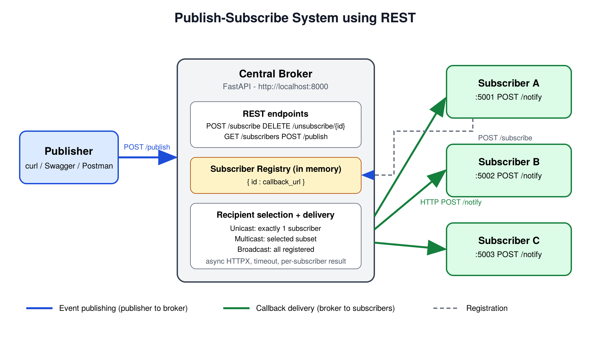
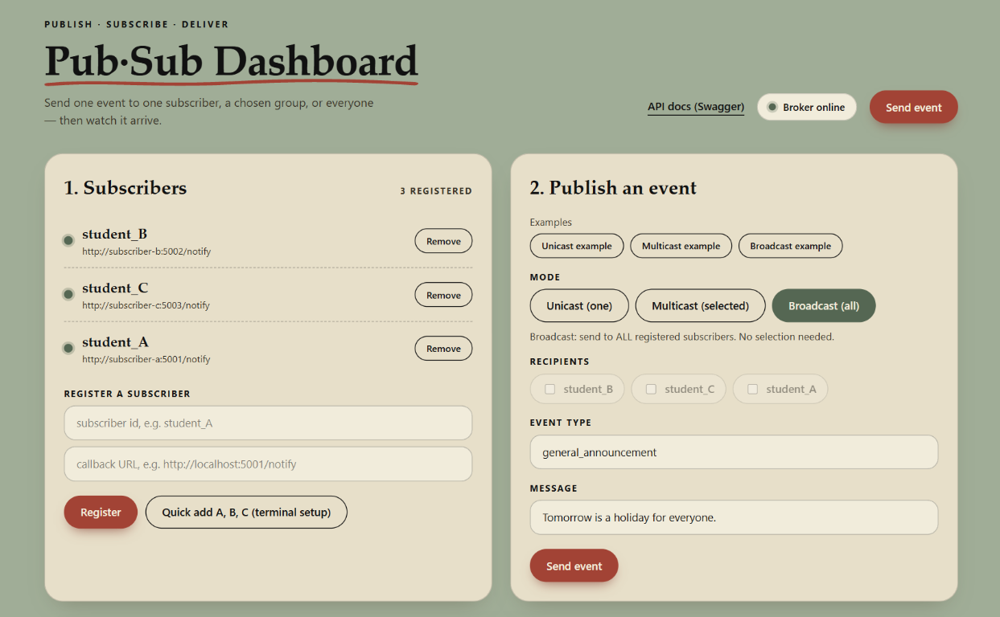

# Simple Publish–Subscribe System using REST

A small Publish–Subscribe (Pub-Sub) system built for the **Distributed Systems** course.

A central **broker** keeps a registry of subscribers. A publisher sends an event to the broker over REST,
and the broker delivers it to subscribers using **HTTP POST callbacks** in one of three modes:

| Mode | Meaning |
|---|---|
| **Unicast** | send to exactly one subscriber |
| **Multicast** | send to a selected group of subscribers |
| **Broadcast** | send to every registered subscriber |

The broker and the subscribers are **separate processes** that talk only over HTTP.

**Tech stack:** Python 3.9+, FastAPI, Uvicorn, HTTPX. The registry is in memory (no database).

---

## 1. Architecture



| Component | Role |
|---|---|
| **Publisher** | Any HTTP client (Swagger UI, Postman, curl) calling `POST /publish` |
| **Central Broker** (port 8000) | Registers subscribers, chooses recipients by mode, sends callbacks, returns a delivery report |
| **Subscriber Registry** | In-memory dictionary `{subscriber_id: callback_url}` inside the broker |
| **Subscribers** (ports 5001–5003) | Independent processes exposing `POST /notify`; each prints the events it receives |

There are two separate flows:
1. **Event publishing:** Publisher → `POST /publish` → Broker
2. **Callback delivery:** Broker → `POST /notify` → selected Subscribers

**What happens when an event is published**
1. The publisher calls `POST /publish` with `event_type`, `message`, `mode` (and `recipients` for unicast/multicast).
2. The broker validates the request and picks the recipients from the registry.
3. It sends an HTTP POST to each recipient's callback URL, concurrently and with a timeout.
4. Each subscriber prints the event in its terminal and replies `200 OK`.
5. The broker returns a delivery report (success or failure per subscriber).

## 2. Project structure

```text
pub-sub-project/
├── broker/
│   ├── main.py          # FastAPI app: REST endpoints and error handlers
│   ├── models.py        # Request/response schemas and the three modes
│   ├── registry.py      # In-memory subscriber registry
│   └── publisher.py     # Recipient selection + HTTP callback delivery
├── subscribers/
│   └── subscriber.py    # Reusable subscriber app (set --id and --port)
├── tests/
│   └── system_test.py   # End-to-end test with real processes
├── scripts/
│   └── demo_requests.sh # Optional curl demo (Linux/macOS/Git Bash)
├── docs/
│   ├── architecture.png / architecture.svg
│   └── DEMO_GUIDE.md    # Script for the demo video
├── requirements.txt
├── README.md
└── .gitignore
```

## 3. Setup

Requires **Python 3.9 or newer**. Run these once, from inside the project folder.

### Ubuntu / Debian
```bash
sudo apt update
sudo apt install python3 python3-venv python3-pip

cd pub-sub-project
python3 -m venv venv
source venv/bin/activate
pip install -r requirements.txt
```

### macOS
```bash
cd pub-sub-project
python3 -m venv venv
source venv/bin/activate
pip install -r requirements.txt
```

### Windows (PowerShell)
Install Python from https://www.python.org/downloads/ and tick **"Add python.exe to PATH"**.
```powershell
cd pub-sub-project
py -m venv venv
venv\Scripts\Activate.ps1
pip install -r requirements.txt
```
If PowerShell refuses to run the activation script, run
`Set-ExecutionPolicy -Scope CurrentUser RemoteSigned` once, or use Command Prompt and
`venv\Scripts\activate.bat` instead. If Windows Firewall asks about Python, choose **Allow**.

## 4. Running the system

### Option 1 – Docker Compose

With Docker Desktop running, open a terminal in the project folder and start the broker and three subscribers:

```bash
docker compose up --build
```

The subscribers register automatically. Open the **Web dashboard** at **http://localhost:8000/dashboard** or **Swagger API docs** at **http://localhost:8000/docs**. Stop the containers with:

```bash
docker compose down
```

### Option 2 – Run locally

Open **four terminals**. In **each** one, go to the project folder and activate the environment:

| OS | Command |
|---|---|
| Ubuntu / Linux / macOS | `source venv/bin/activate` |
| Windows PowerShell | `venv\Scripts\Activate.ps1` |
| Windows Command Prompt | `venv\Scripts\activate.bat` |

Then start one process per terminal (these commands are the same on every OS):

**Terminal 1 – Broker**
```bash
uvicorn broker.main:app --host 127.0.0.1 --port 8000
```

**Terminal 2 – Subscriber A**
```bash
python -m subscribers.subscriber --id student_A --port 5001
```

**Terminal 3 – Subscriber B**
```bash
python -m subscribers.subscriber --id student_B --port 5002
```

**Terminal 4 – Subscriber C**
```bash
python -m subscribers.subscriber --id student_C --port 5003
```

After all four processes are running, choose either interface:

- **Web dashboard:** http://localhost:8000/dashboard
- **Swagger API docs:** http://localhost:8000/docs



> **Register subscribers once.** The commands above do not register them automatically. In the dashboard, click **Quick add A, B, C (terminal setup)**, or register each subscriber through Swagger as shown in step 1 below. If you restart the broker, register them again.

<details>
<summary>Optional settings</summary>

- Subscriber flags: `--register` (register with the broker automatically), `--broker-url URL`,
  `--host HOST`, `--delay SECONDS` (simulate a slow subscriber to show the timeout).
- Broker callback timeout (seconds, default 5), set before starting the broker:
  - Linux/macOS: `PUBSUB_CALLBACK_TIMEOUT=3 uvicorn broker.main:app --port 8000`
  - Windows PowerShell: `$env:PUBSUB_CALLBACK_TIMEOUT=3; uvicorn broker.main:app --port 8000`
</details>

## 5. Demo walkthrough

### Option A – Web dashboard

Open **http://localhost:8000/dashboard** and click **Quick add A, B, C (terminal setup)** after starting the four processes in section 4. Choose Unicast, Multicast, or Broadcast, then click **Send event**. The dashboard shows the delivery report; the subscriber terminals show which subscribers received the event.

### Option B – Swagger UI or cURL

Use Swagger at **http://localhost:8000/docs**, Postman, or the curl commands shown below. Watch the three subscriber terminals after each publish.

**Step 1 – Register the three subscribers** (`POST /subscribe`, once per body)
```json
{"subscriber_id": "student_A", "callback_url": "http://localhost:5001/notify"}
{"subscriber_id": "student_B", "callback_url": "http://localhost:5002/notify"}
{"subscriber_id": "student_C", "callback_url": "http://localhost:5003/notify"}
```

**Step 2 – View the registry** (`GET /subscribers`)

**Step 3 – Unicast** (`POST /publish`) → only student_A prints the event
```json
{"event_type": "fee_reminder", "message": "Your fee payment is due tomorrow.", "mode": "unicast", "recipients": ["student_A"]}
```

**Step 4 – Multicast** → student_A and student_C print it, student_B does not
```json
{"event_type": "hackathon_update", "message": "Hackathon registration closes tomorrow.", "mode": "multicast", "recipients": ["student_A", "student_C"]}
```

**Step 5 – Broadcast** → all three print it
```json
{"event_type": "general_announcement", "message": "Tomorrow is a holiday for everyone.", "mode": "broadcast"}
```

**Step 6 – Failure handling:** stop subscriber B (`Ctrl+C` in its terminal) and broadcast again.
The report shows B as `failed`, while A and C still receive the event.

**Step 7 – Unregister:** `DELETE /unsubscribe/student_C`, then broadcast again. C no longer receives it.

<details>
<summary>Same requests with curl (Linux / macOS / Git Bash)</summary>

```bash
curl -X POST http://localhost:8000/subscribe -H "Content-Type: application/json" \
  -d '{"subscriber_id": "student_A", "callback_url": "http://localhost:5001/notify"}'

curl -X POST http://localhost:8000/publish -H "Content-Type: application/json" \
  -d '{"event_type": "general_announcement", "message": "Tomorrow is a holiday for everyone.", "mode": "broadcast"}'
```
`./scripts/demo_requests.sh` runs steps 1–5 and pauses before each one.
</details>

<details>
<summary>Same request in Windows PowerShell</summary>

```powershell
Invoke-RestMethod -Method Post -Uri http://localhost:8000/publish -ContentType "application/json" `
  -Body '{"event_type":"general_announcement","message":"Tomorrow is a holiday for everyone.","mode":"broadcast"}'
```
</details>

**What a subscriber prints**
```text
=================================
SUBSCRIBER student_A
=================================
New Event Received!

Event: general_announcement
Message: Tomorrow is a holiday for everyone.
Mode: broadcast
From: main_broker
=================================
```

## 6. API reference

| Method | Endpoint | Purpose | Success | Errors |
|---|---|---|---|---|
| `POST` | `/subscribe` | Register a subscriber | `201` | `409` duplicate ID, `422` invalid/missing fields |
| `DELETE` | `/unsubscribe/{subscriber_id}` | Remove a subscriber | `200` | `404` unknown ID |
| `GET` | `/subscribers` | List registered subscribers | `200` | – |
| `POST` | `/publish` | Publish an event | `200` + delivery report | `400` wrong recipients for the mode, `404` unknown recipient(s), `422` invalid mode/missing fields |

**Publish request fields:** `event_type` (required), `message` (required), `mode` (`unicast` | `multicast` | `broadcast`),
`recipients` (list of IDs: exactly one for unicast, one or more for multicast, ignored for broadcast).

**Callback payload sent to each subscriber** (`POST /notify`)
```json
{
  "event_id": "5b0f6c1e-...",
  "event_type": "holiday_announcement",
  "message": "Tomorrow is a holiday!",
  "publisher": "main_broker",
  "mode": "broadcast",
  "timestamp": "2026-11-11T10:00:00+00:00"
}
```

**Delivery report returned by `/publish`** (example with one subscriber offline)
```json
{
  "message": "Event processing completed",
  "event_id": "5b0f6c1e-...",
  "event_type": "general_announcement",
  "mode": "broadcast",
  "total_recipients": 3,
  "successful_deliveries": 2,
  "failed_deliveries": 1,
  "invalid_recipients": [],
  "results": [
    {"subscriber_id": "student_A", "status": "success", "http_status": 200},
    {"subscriber_id": "student_B", "status": "failed", "error": "Connection refused (subscriber offline or unreachable)"},
    {"subscriber_id": "student_C", "status": "success", "http_status": 200}
  ]
}
```

## 7. Error handling

| Situation | Behaviour |
|---|---|
| Subscriber offline or unreachable | That delivery is `failed`; the others still go through |
| Callback timeout | That delivery is `failed` (`Timeout: no response within Ns`); the broker never waits indefinitely |
| Subscriber replies with a non-2xx status | That delivery is `failed` with the HTTP status |
| Unknown subscriber ID | Unicast → `404`. Multicast → listed in `invalid_recipients`; valid IDs still receive the event |
| Invalid mode, missing fields, bad callback URL | `422` with details |
| Wrong number of recipients for the mode | `400` with an explanation |
| Duplicate registration | `409` |
| Unregistering an unknown ID | `404` |

## 8. Automated test

Starts a real broker and real subscribers on free ports, tests every endpoint and mode, and checks
delivery by reading each subscriber's terminal output.

```bash
python tests/system_test.py
```
(Run it with the virtual environment active.) Expected last line: `Result: 36 passed, 0 failed`.

## 9. Limitations

- The registry is in memory, so restarting the broker clears all registrations.
- Delivery is at-most-once: no retries, persistence or ordering guarantees.
- A single broker is a single point of failure.
- No authentication or encryption (local demonstration only).
- Offline subscribers are not removed automatically; unregister them explicitly.